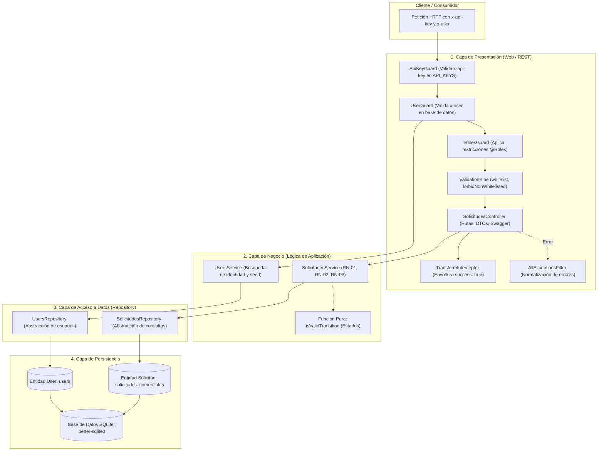
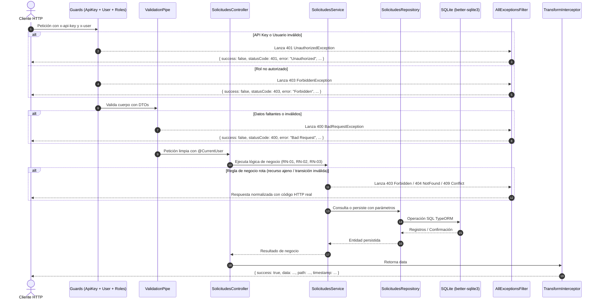

# API REST de Solicitudes de Seguimiento Comercial

API REST robusta desarrollada con **NestJS**, **TypeScript** y **TypeORM (SQLite)** para la gestión y seguimiento del ciclo de vida de solicitudes comerciales. Diseñada bajo una arquitectura **N-tier** estricta, desacoplada en capas de presentación, negocio, acceso a datos y datos, implementando seguridad mediante encabezados `x-api-key` y control de acceso basado en roles (`x-user`).

---

## Índice
1. [Descripción y Características](#descripción-y-características)
2. [Arquitectura del Sistema](#arquitectura-del-sistema)
3. [Tecnologías y Requisitos](#tecnologías-y-requisitos)
4. [Variables de Entorno](#variables-de-entorno)
5. [Instalación y Ejecución Local](#instalación-y-ejecución-local)
6. [Ejecución con Docker](#ejecución-con-docker)
7. [Usuarios de Prueba y Roles](#usuarios-de-prueba-y-roles)
8. [Documentación Swagger / OpenAPI](#documentación-swagger--openapi)
9. [Matriz de Endpoints y Permisos](#matriz-de-endpoints-y-permisos)
10. [Tabla de Códigos HTTP](#tabla-de-códigos-http)
11. [Reglas de Negocio Implementadas](#reglas-de-negocio-implementadas)
12. [Ejecución de Pruebas](#ejecución-de-pruebas)
13. [Evidencias con cURL](#evidencias-con-curl)
14. [Supuestos y Decisiones de Diseño](#supuestos-y-decisiones-de-diseño)
15. [Estructura de Carpetas](#estructura-de-carpetas)

---

## Descripción y Características

- **Seguridad perimetral**: Todos los endpoints exigen el encabezado `x-api-key`, validado contra múltiples claves simultáneas configuradas en el entorno sin exponer secretos en código.
- **Autenticación e Identidad**: El cliente envía su identidad en el encabezado `x-user`. El rol se consulta exclusivamente en la base de datos real (nunca aceptado desde encabezados del cliente).
- **Control de Acceso basado en Roles (RBAC)**: Autorización aplicada mediante decorador `@Roles` y `RolesGuard` a nivel global con `APP_GUARD`.
- **Estandarización de Respuestas**: Interceptor global (`TransformInterceptor`) que envuelve todas las respuestas exitosas en `{ success: true, data, path, timestamp }`.
- **Manejo Centralizado de Errores**: Filtro de excepciones global (`AllExceptionsFilter`) con `@Catch()` que normaliza errores en `{ success: false, statusCode, error, message, path, timestamp }` preservando el código HTTP real sin transformar errores en 500 indiscriminados.
- **Validación Estricta de Datos**: `ValidationPipe` global con `whitelist: true`, `forbidNonWhitelisted: true` y `transform: true`.
- **Máquina de Estados Finita**: Control riguroso del ciclo de vida de cada solicitud (`PENDIENTE` -> `EN_GESTION` -> `RESUELTA`) implementado mediante función pura.

---

## Arquitectura del Sistema

El proyecto sigue una arquitectura **N-Tier** estricta dentro de módulos de NestJS, donde cada capa tiene responsabilidades únicas y solo depende de la inmediatamente inferior:



### Flujo de una Petición HTTP



1. **Entrada**: La petición arriba al servidor HTTP con los encabezados obligatorios.
2. **ApiKeyGuard**: Verifica el encabezado `x-api-key`. Si falta o no coincide con ninguna clave de `API_KEYS`, lanza `401 UnauthorizedException`.
3. **UserGuard**: Extrae el encabezado `x-user`, consulta al `UsersService` para verificar existencia en base de datos e inyecta la entidad `User` en `request.user`. Si no existe o falta, lanza `401 UnauthorizedException`.
4. **RolesGuard**: Lee los metadatos de `@Roles` del endpoint y valida que el rol del usuario autenticado esté autorizado. Si no, lanza `403 ForbiddenException`.
5. **ValidationPipe**: Valida y transforma el body de la petición según los DTOs (`whitelist`, `forbidNonWhitelisted`). Si falla, lanza `400 BadRequestException`.
6. **Controller**: Recibe la petición limpia y delega la ejecución al Service correspondiente.
7. **Service**: Aplica las reglas de negocio (ej. asignación automática de asesor en RN-01, validación de propiedad en RN-02 y orden de chequeos en RN-03).
8. **Repository**: Construye y ejecuta las consultas en la base de datos SQLite según los parámetros recibidos.
9. **TransformInterceptor**: Captura el resultado exitoso y lo formatea en el sobre estándar `{ success: true, data, path, timestamp }`.
10. **AllExceptionsFilter**: En caso de cualquier error (de validación, conflicto, negocio o inesperado), intercepta la excepción y retorna el formato `{ success: false, statusCode, error, message, path, timestamp }`.

---

## Tecnologías y Requisitos

- **Node.js**: v20.x o superior.
- **Gestor de paquetes**: `pnpm` (v9 o superior).
- **Framework**: NestJS v12.
- **Lenguaje**: TypeScript v6.
- **ORM**: TypeORM con SQLite (`better-sqlite3`).
- **Contenedores**: Docker y Docker Compose.
- **Testing**: Vitest + Supertest.
- **Linter**: Oxlint.

---

## Variables de Entorno

Configura el archivo `.env` en la raíz del proyecto a partir de `.env.example`:

| Variable | Tipo | Descripción | Ejemplo |
| :--- | :--- | :--- | :--- |
| `PORT` | Number | Puerto en el que escucha el servidor HTTP | `3000` |
| `NODE_ENV` | String | Entorno de ejecución (`development`, `production`, `test`) | `development` |
| `API_KEYS` | String | Lista de claves de API válidas separadas por comas (sin espacios o con trim) | `key-client-alpha-12345,key-client-beta-67890` |
| `DB_DATABASE` | String | Ruta del archivo de base de datos SQLite o `:memory:` para pruebas | `database.sqlite` |

---

## Instalación y Ejecución Local

1. **Clonar el repositorio**:
   ```bash
   git clone https://github.com/alejandroesbr/api-solicitudes.git
   cd api-solicitudes
   ```

2. **Instalar dependencias con pnpm**:
   ```bash
   pnpm install
   ```

3. **Configurar el archivo de entorno**:
   ```bash
   cp .env.example .env
   ```

4. **Compilar el proyecto**:
   ```bash
   pnpm build
   ```

5. **Iniciar en modo desarrollo**:
   ```bash
   pnpm start:dev
   ```

6. **Iniciar en modo producción**:
   ```bash
   pnpm start:prod
   ```

---

## Ejecución con Docker

La aplicación está preparada para ser construida y ejecutada en contenedores Docker mediante una imagen multi-stage optimizada y liviana:

1. **Construir y levantar el contenedor**:
   ```bash
   docker compose up --build -d
   ```

2. **Verificar logs del contenedor**:
   ```bash
   docker compose logs -f api
   ```

3. **Detener el servicio**:
   ```bash
   docker compose down
   ```

> **Nota de persistencia**: El archivo SQLite se almacena en el volumen persistente `sqlite_data` montado en `/app/data/database.sqlite`.

---

## Usuarios de Prueba y Roles

Al arrancar la aplicación por primera vez, el servicio `UsersService` realiza un sembrado automático (seed) idempotente en la tabla `users` con los siguientes usuarios de prueba:

| Username (`x-user`) | Rol (`UserRole`) | Permisos Principales |
| :--- | :--- | :--- |
| `admin` | `admin` | Crea solicitudes asignando cualquier asesor, consulta **todas** las solicitudes y modifica el estado de cualquiera. |
| `supervisor` | `supervisor` | Revisa y asigna solicitudes a cualquier asesor, consulta **todas** y modifica el estado de cualquiera. |
| `asesor1` | `asesor` | Registra solicitudes (autoasignado), consulta **únicamente** sus solicitudes y cambia el estado **solo** de las suyas. |
| `asesor2` | `asesor` | Mismos permisos de asesor; aislado operativamente de las solicitudes de `asesor1`. |

---

## Documentación Swagger / OpenAPI

La especificación Swagger interactiva está disponible al iniciar la aplicación en:
- **URL UI interactiva**: [http://localhost:3000/api/docs](http://localhost:3000/api/docs)
- **URL JSON OpenAPI**: [http://localhost:3000/api/docs-json](http://localhost:3000/api/docs-json)

### Cómo autenticarse en Swagger UI:
1. Haz clic en el botón superior verde **Authorize**.
2. En el campo `x-api-key`, ingresa: `key-client-alpha-12345`.
3. En el campo `x-user`, ingresa: `admin` (o `supervisor`, `asesor1`, `asesor2`).
4. Haz clic en **Authorize** y luego en **Close**. Todas las peticiones ejecutadas desde la interfaz incluirán ambos encabezados obligatorios.

---

## Matriz de Endpoints y Permisos

Todos los endpoints requieren obligatoriamente los encabezados `x-api-key` y `x-user` válidos.

| Método | Endpoint | Roles Autorizados | Descripción | Códigos HTTP |
| :--- | :--- | :--- | :--- | :--- |
| `POST` | `/solicitudes` | `admin`, `supervisor`, `asesor` | Registra una nueva solicitud comercial en estado `PENDIENTE`. Si es asesor, se autoasigna; si es admin/supervisor, el campo `asesor` es obligatorio y debe existir con rol asesor. | `201`, `400`, `401`, `403` |
| `GET` | `/solicitudes` | `admin`, `supervisor`, `asesor` | Consulta solicitudes. Admin y supervisor consultan todas. Asesor consulta solo las asignadas a su username (filtro en el WHERE). | `200`, `401`, `403` |
| `GET` | `/solicitudes/:id` | `admin`, `supervisor`, `asesor` | Consulta individual por ID. Si un asesor intenta consultar una solicitud ajena, responde `403 Forbidden`. | `200`, `400`, `401`, `403`, `404` |
| `PATCH` | `/solicitudes/:id/estado` | `admin`, `supervisor`, `asesor` | Actualiza el estado respetando las transiciones válidas. Asesor solo puede cambiar sus solicitudes. | `200`, `400`, `401`, `403`, `404`, `409` |

---

## Tabla de Códigos HTTP

| Código | Significado | Escenarios de Aplicación |
| :--- | :--- | :--- |
| **`200 OK`** | Petición exitosa | Consulta de solicitudes (`GET`), consulta individual (`GET :id`) y cambio de estado exitoso (`PATCH :id/estado`). |
| **`201 Created`** | Recurso creado | Registro exitoso de una nueva solicitud comercial (`POST /solicitudes`). |
| **`400 Bad Request`** | Error de validación | DTO inválido, campos obligatorios vacíos o con solo espacios, caracteres excedidos (>255), campo `estado` enviado en POST, tipo de dato inválido, parámetro `:id` no numérico (`ParseIntPipe`), o asesor no asignado/inexistente por admin/supervisor. |
| **`401 Unauthorized`** | No autenticado | Falta encabezado `x-api-key`, clave de API inválida, falta encabezado `x-user`, o usuario no registrado en base de datos. |
| **`403 Forbidden`** | Prohibido / Sin permisos | Rol no autorizado según metadatos de `@Roles`, o un asesor intentando consultar o cambiar el estado de una solicitud ajena. |
| **`404 Not Found`** | Recurso no encontrado | Solicitud comercial con el ID indicado no existe en la base de datos. |
| **`409 Conflict`** | Conflicto de estado | Transición de estado inválida: salto prohibido (`PENDIENTE` -> `RESUELTA`), reapertura (`RESUELTA` -> `EN_GESTION`), retroceso (`EN_GESTION` -> `PENDIENTE`), o transición al mismo estado (`PENDIENTE` -> `PENDIENTE`). |
| **`500 Internal Server Error`** | Error interno | Excepciones no controladas; procesadas por `AllExceptionsFilter` sin filtrar detalles sensibles ni exponer stack traces al cliente. |

---

## Reglas de Negocio Implementadas

- **RN-01 Registro de Solicitudes**: Estado inicial siempre `PENDIENTE`. Si el creador es asesor, el campo `asesor` se fija a su propio usuario; si el creador es admin o supervisor, debe proveer un asesor válido existente con rol `asesor`.
- **RN-02 Consulta de Solicitudes**: Asesores filtran en la consulta SQL TypeORM (`WHERE asesor = :username`). Admin y supervisor consultan todas las solicitudes.
- **RN-03 Cambio de Estado**: Orden estricto de comprobaciones:
  1. Existencia del recurso (si no existe -> `404 Not Found`).
  2. Comprobación de propiedad (si es asesor y la solicitud es ajena -> `403 Forbidden`).
  3. Comprobación de transición (si es inválida -> `409 Conflict`).
- **RN-04 Protección por API Key**: Soporte de múltiples claves separadas por coma en `API_KEYS`. Manejo de arrays o strings en encabezados HTTP. Falla en el arranque si `API_KEYS` está ausente o vacía.
- **RN-05 Validación Estricta**: `ValidationPipe` con sanitización `trim()`, rechazo de propiedades desconocidas o protegidas (`forbidNonWhitelisted: true`).
- **RN-06 Respuestas Estandarizadas**: Interceptor global de éxito y filtro centralizado de excepciones.

---

## Ejecución de Pruebas

El proyecto cuenta con una cobertura integral de pruebas unitarias y de integración end-to-end (E2E) con Vitest y Supertest:

```bash
# Ejecutar pruebas unitarias (máquina de transiciones de estado)
pnpm test

# Ejecutar pruebas E2E (cobertura completa de los 12 criterios de aceptación)
pnpm test:e2e

# Ejecutar linter de código
pnpm lint

# Ejecutar cobertura de código
pnpm test:cov
```

---

## Evidencias con cURL

Se incluye un script ejecutable en `docs/curl-test.sh` con 19 pruebas automatizadas con salida a color.

Para ejecutarlo contra una instancia activa:
```bash
./docs/curl-test.sh
```

### Ejemplos manuales con cURL:

#### 1. Registrar solicitud como asesor:
```bash
curl -i -X POST 'http://localhost:3000/solicitudes' \
  -H 'x-api-key: key-client-alpha-12345' \
  -H 'x-user: asesor1' \
  -H 'Content-Type: application/json' \
  -d '{
    "cliente": "Empresa Alfa SAS",
    "descripcion": "Solicitud de cotización de servicios cloud"
  }'
```

#### 2. Registrar solicitud como supervisor asignando a asesor2:
```bash
curl -i -X POST 'http://localhost:3000/solicitudes' \
  -H 'x-api-key: key-client-beta-67890' \
  -H 'x-user: supervisor' \
  -H 'Content-Type: application/json' \
  -d '{
    "cliente": "Corporación Global",
    "descripcion": "Asesoría para migración de datos",
    "asesor": "asesor2"
  }'
```

#### 3. Consultar solicitudes como asesor1 (solo ve las suyas):
```bash
curl -i -X GET 'http://localhost:3000/solicitudes' \
  -H 'x-api-key: key-client-alpha-12345' \
  -H 'x-user: asesor1'
```

#### 4. Cambiar estado de PENDIENTE a EN_GESTION:
```bash
curl -i -X PATCH 'http://localhost:3000/solicitudes/1/estado' \
  -H 'x-api-key: key-client-alpha-12345' \
  -H 'x-user: asesor1' \
  -H 'Content-Type: application/json' \
  -d '{
    "estado": "EN_GESTION"
  }'
```

#### 5. Transición inválida (ejemplo: salto prohibido a RESUELTA):
```bash
curl -i -X PATCH 'http://localhost:3000/solicitudes/2/estado' \
  -H 'x-api-key: key-client-alpha-12345' \
  -H 'x-user: supervisor' \
  -H 'Content-Type: application/json' \
  -d '{
    "estado": "RESUELTA"
  }'
```
*Respuesta esperada: HTTP 409 Conflict.*

---

## Supuestos y Decisiones de Diseño

1. **Uso de SQLite y `synchronize: true`**:
   Para los fines de esta prueba de desempeño técnica, se habilitó `synchronize: true` en TypeORM SQLite para generar automáticamente las tablas (`users`, `solicitudes_comerciales`) al iniciar la aplicación sin requerir migraciones manuales.
2. **Driver SQLite `better-sqlite3`**:
   Debido a que TypeORM 1.1+ modernizó sus controladores SQLite adoptando `better-sqlite3` como el estándar sincrónico de alto rendimiento, se configuró el controlador `better-sqlite3` agregándolo a `pnpm.onlyBuiltDependencies` para compilar sin problemas tanto en local como dentro del contenedor Docker.
3. **Persistencia de Usuarios y Seed**:
   El sembrado de usuarios se ejecuta en el hook `onModuleInit` de `UsersService` si la tabla `users` está vacía, garantizando la existencia de `admin`, `supervisor`, `asesor1` y `asesor2` tanto en desarrollo local como en memoria para las pruebas E2E.
4. **Validación de Propiedad vs Restricción por Roles**:
   La autorización general de roles se maneja mediante metadatos declarativos `@Roles(...)` y `RolesGuard`, mientras que la validación contextual de propiedad (asesor solo puede operar sobre sus solicitudes) se ejecuta en la capa de negocio (`SolicitudesService`), respondiendo de forma consistente con `403 Forbidden`.
5. **Aislamiento en pruebas E2E**:
   Las pruebas E2E usan base de datos SQLite en memoria (`DB_DATABASE=:memory:`) y API keys de prueba independientes, evitando efectos colaterales sobre la base de datos de desarrollo.

---

## Estructura de Carpetas

```text
api-solicitudes/
├── docs/
│   └── curl-test.sh                     # Script de pruebas con cURL
├── src/
│   ├── app.module.ts                    # Módulo principal y validación de entorno
│   ├── main.ts                          # Bootstrap de la aplicación y Swagger
│   ├── setup-app.ts                     # Configuración global de pipes, filtros e interceptores
│   ├── core/
│   │   ├── constants/ & enums/
│   │   │   ├── roles.enum.ts            # Enum UserRole (admin, supervisor, asesor)
│   │   │   └── estados.enum.ts          # Enum EstadoSolicitud (PENDIENTE, EN_GESTION, RESUELTA)
│   │   ├── decorators/
│   │   │   ├── roles.decorator.ts       # Decorador @Roles
│   │   │   ├── current-user.decorator.ts# Decorador @CurrentUser
│   │   │   └── api-envelope-response.decorator.ts # Documentación Swagger para sobres de respuesta
│   │   ├── dto/
│   │   │   └── envelope-response.dto.ts # DTOs de sobres estándar y error para Swagger
│   │   ├── filters/
│   │   │   └── all-exceptions.filter.ts # Filtro centralizado de excepciones HTTP y 500
│   │   ├── guards/
│   │   │   ├── api-key.guard.ts         # Guard de validación x-api-key
│   │   │   ├── user.guard.ts            # Guard de identidad x-user contra base de datos
│   │   │   └── roles.guard.ts           # Guard de autorización por rol
│   │   └── interceptors/
│   │       └── transform.interceptor.ts # Interceptor estandarizador de respuestas exitosas
│   └── modules/
│       ├── users/
│       │   ├── entities/
│       │   │   └── user.entity.ts       # Entidad User (tabla users)
│       │   ├── repositories/
│       │   │   └── users.repository.ts  # Repositorio N-tier de usuarios
│       │   ├── services/
│       │   │   └── users.service.ts     # Servicio de usuarios y seed
│       │   └── users.module.ts          # Módulo de usuarios
│       └── solicitudes/
│           ├── controllers/
│           │   └── solicitudes.controller.ts # Controlador REST con Swagger
│           ├── dto/
│           │   ├── create-solicitud.dto.ts        # DTO de creación con validaciones
│           │   ├── update-estado-solicitud.dto.ts # DTO de actualización de estado
│           │   └── solicitud-response.dto.ts      # DTO de respuesta para Swagger
│           ├── entities/
│           │   └── solicitud.entity.ts            # Entidad TypeORM (solicitudes_comerciales)
│           ├── repositories/
│           │   └── solicitudes.repository.ts      # Repositorio propio desacoplado de TypeORM
│           ├── services/
│           │   ├── solicitudes.service.ts         # Lógica de negocio (RN-01, RN-02, RN-03)
│           │   ├── solicitud-transitions.ts       # Función pura de transiciones de estado
│           │   └── solicitud-transitions.spec.ts  # Pruebas unitarias de transiciones
│           └── solicitudes.module.ts              # Módulo de solicitudes
├── test/
│   └── app.e2e-spec.ts                  # Pruebas E2E completas (12 Criterios)
├── .dockerignore
├── .env.example
├── .gitignore
├── docker-compose.yml
├── Dockerfile
├── package.json
├── pnpm-lock.yaml
├── tsconfig.json
├── tsconfig.build.json
├── vitest.config.mts
└── vitest.config.e2e.mts
```
